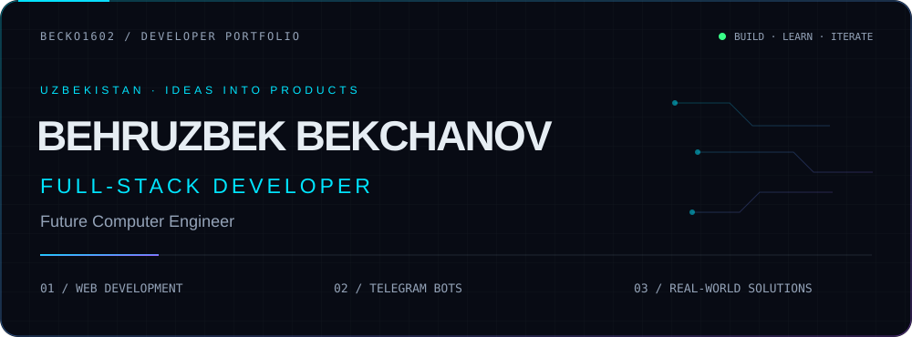
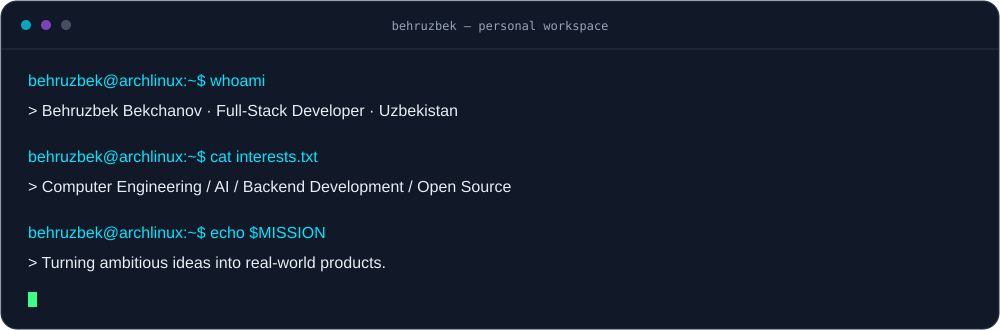
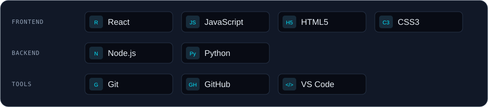
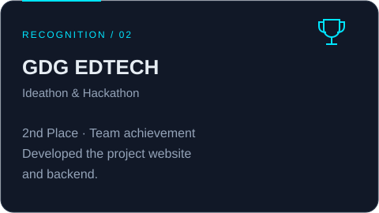
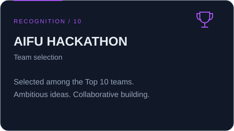

<picture>
  <source media="(prefers-reduced-motion: reduce)" srcset="assets/hero-static.svg">
  
</picture>

<picture>
  <source media="(prefers-reduced-motion: reduce)" srcset="assets/typing-static.svg">
  
</picture>

[GitHub @becko1602](https://github.com/becko1602) · Uzbekistan · Web development & Telegram bots

### 01 / About me

I'm **Behruzbek Bekchanov**, a full-stack developer from Uzbekistan. I build websites and Telegram bots, working with React, JavaScript, HTML, and CSS on the frontend, and Node.js and Python on the backend. **Node.js is my preferred backend environment.**

I'm interested in Computer Engineering and Artificial Intelligence, and I enjoy turning practical problems into useful software. Right now, I'm exploring databases, strengthening my backend skills, and learning how to structure applications as they grow.

<picture>
  <source media="(prefers-reduced-motion: reduce)" srcset="assets/terminal-static.svg">
  
</picture>

### 02 / Development toolkit

Frontend: React, JavaScript, HTML5, CSS3 · Backend: Node.js, Python · Tools: Git, GitHub, VS Code.

**Currently learning** — Databases · Backend architecture · Computer Engineering concepts

### 03 / Team achievements

### 04 / Project workspace

My work includes **websites and Telegram bots**, with a focus on practical, useful experiences.

[Explore my public repositories →](https://github.com/becko1602?tab=repositories)

*Individual project highlights will be added once their repositories and technology stacks are verified.*

### 05 / Open-source activity

[View my contribution history →](https://github.com/becko1602?tab=overview)

The GitHub contribution graph on this profile shows my public activity. I keep this space focused on my work, without third-party statistics widgets.

### 06 / Connect

Find me on [GitHub — @becko1602](https://github.com/becko1602).

