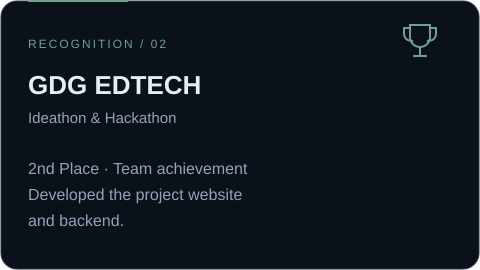
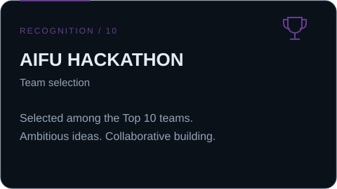

<picture>
  <source media="(prefers-reduced-motion: reduce)" srcset="assets/hero-static.svg">
  
</picture>

<picture>
  <source media="(prefers-reduced-motion: reduce)" srcset="assets/roles-static.svg">
  
</picture>

<a href="#about">About</a> · <a href="#projects">Projects</a> · <a href="#experiences">Experiences</a> · <a href="#kaist">KAIST journey</a> · <a href="#activity">Activity</a> · <a href="#connect">Connect</a>

<picture>
  <source media="(prefers-reduced-motion: reduce)" srcset="assets/becko-neon-static.svg">
  
</picture>

## 01 / The developer behind the terminal

I'm **Behruzbek Bekchanov**, a developer from **Uzbekistan** building websites, Telegram bots, and AI-assisted applications. I work across frontend and backend development, with Node.js as my preferred backend environment, and enjoy turning practical problems into useful software.

My interests span **artificial intelligence, cybersecurity, Linux, Computer Science, and Computer Engineering**. Arch Linux, Hyprland, terminal workflows, automation, and AI assistants are part of how I explore and build. Hackathons give me space to test ideas, collaborate, and learn through real constraints.

My long-term ambition is to gain international experience and build impactful technologies, products, and startups that create opportunities in Uzbekistan.

<picture>
  <source media="(prefers-reduced-motion: reduce)" srcset="assets/terminal-static.svg">
  
</picture>

## 02 / Development toolkit

<picture>
  <source media="(prefers-reduced-motion: reduce)" srcset="assets/tech-stack-static.svg">
  
</picture>

These are technologies I use or explore across public and local projects, rather than claims of advanced mastery. Next.js is evidenced in local OLYMPIX and Smart Market Prices work; FastAPI and Docker¹ are evidenced in the local UZEX Intelligence workspace.

## 03 / Selected builds

Public source is linked below. Implementation descriptions come from inspected source and documentation; live integrations still require their own configuration.

<table>
<tr><td width="50%" valign="top">

### ◈ eDOSKA
**A digital workspace for the classroom.**

Whiteboard, lessons, schedules, student selection, analytics views, AI assistant and lesson-generation components, and a Telegram Mini App interface. External AI and database integrations require configuration.

`React` `TypeScript` `Vite` `Tailwind CSS` `Supabase`

**Status:** source implementation; deployment listed in repository metadata.

[Source ↗](https://github.com/becko1602/eDoska)

</td><td width="50%" valign="top">

### ◈ BECKO AI ASSISTANT
**A voice-driven Windows assistant.**

Gemini Live conversation, screen context, desktop tools, persistent memory, Telegram remote control, and a central action-confirmation gate. Requires Windows, audio hardware, and configured API credentials.

`Python` `Gemini Live` `Tkinter` `Telegram`

**Status:** self-hosted implementation; customized from [Kaizumi by Musayev Doniyor](https://github.com/MusayevDoniyor/kaizumi), with upstream attribution preserved.

[Source ↗](https://github.com/becko1602/Becko)

</td></tr>
<tr><td width="50%" valign="top">

### ◈ BECKO ARCH LINUX
**A native terminal voice assistant for Arch.**

Gemini Live, a Textual terminal interface, sounddevice/PipeWire audio, system information and Linux desktop tools. A separate Linux implementation, with live voice requiring a configured Gemini key.

`Python` `Textual` `google-genai` `sounddevice` `psutil`

**Status:** source implementation; hardware and API setup required.

[Source ↗](https://github.com/becko1602/becko-arch-linux)

</td><td width="50%" valign="top">

### ◈ BUILDING IN THE OPEN
**Small steps count, too.**

[Code](https://github.com/becko1602/Code) and [Test-1](https://github.com/becko1602/Test-1) are small practice repositories; their metadata does not establish a substantial product or technology stack.

[All public repositories ↗](https://github.com/becko1602?tab=repositories)

</td></tr>
</table>

<b>Local projects &amp; product directions</b> — source visibility and implementation boundaries

| Project | Evidence and current scope | Stack / status |
| :--- | :--- | :--- |
| **OLYMPIX** | Local exam-preparation application for IELTS and Digital SAT, with practice and diagnostic flows described in its source documentation. Daily challenges, AI study planning and multilingual ambitions are not all established as working integrations. | Next.js, React, TypeScript, Tailwind, Supabase. Local implementation; no public repository verified. |
| **SMART MARKET PRICES** | Local competition MVP with supplier comparison, quantity requests, persisted workflows, synthetic market demonstrations and configurable AI/voice interpretation. Telegram integration code exists; operation of the user-supplied [@SmartMarketPricesBot](https://t.me/SmartMarketPricesBot) was not verified. | Next.js, TypeScript, Node.js, SQLite; PostgreSQL/Prisma path documented but requires validation. No public repository verified. |
| **UZEX INTELLIGENCE** | Local FastAPI/DuckDB analytics backend and React dashboard: read-only queries, transaction search, regional/year comparisons, Uzbek/Russian assistant and Telegram integration code. No forecasting or live deployment claim. The requested `uzex-backend` and `uzex-frontend` were not in the public repository listing. | Python, FastAPI, DuckDB, React, Vite, aiogram, Docker. Local implementation; database and live integration verification required. |
| **FALCON** | Cybersecurity learning concept: interactive lessons, CTF-style challenges, progress, leaderboards and personalization are proposed features. | Concept supplied by the author; source and stack not verified. |

No repository or demo URLs are invented for these projects.

## 04 / HACKATHONS & BUILDING EXPERIENCES

The original profile records the team results below. Other participation entries are supplied by me; dates are shown only where supplied. Undated experiences are grouped without inventing a chronological order.

| Journey | Category | Experience / evidence |
| :--- | :--- | :--- |
| ◆ GDG EdTech Ideathon & Hackathon · date unspecified | **Award / team build** | **2nd place with my team**, recorded in the previous profile. My contribution: website and backend. This result is specific to this event. |
| ◆ AIFU · 2026 participation supplied | **Hackathon** | The previous profile records selection among the **Top 10 teams** at AIFU; the year of that result was not recorded. |
| │ AI500 · date unspecified | **Hackathon participation** | AI-focused innovation and practical technology development. |
| │ EdTech Hackathon · date unspecified | **Hackathon participation** | Exploring classroom and education technology ideas; no additional award claimed. |
| │ Ideathon · date unspecified | **Idea development** | Startup thinking and product concepts; no separate award claimed. |
| │ Founders Camp · 2026 | **Startup experience** | Participation related to entrepreneurship and product development. |
| ◇ Google Developer Groups · dates unspecified | **Developer community** | Developer events, workshops and technology sessions. |
| ◇ Informatics Olympiad · confirmation pending | **Competition** | Regional result, date and ranking are not yet documented here. |

Original achievement artwork

## 05 / MY JOURNEY TO KAIST

**Korea Advanced Institute of Science and Technology** is a personal academic destination. My interests are Computer Science, Software Engineering, Artificial Intelligence, and Computer Engineering.

My self-reported GPA is **approximately 4.6/5.0**. I'm strengthening Mathematics and Computer Science, preparing for IELTS, and working toward a **SAT target of 1500+**. International study and a scholarship are goals; no test results, admission offer or scholarship are claimed.

<picture>
  <source media="(prefers-reduced-motion: reduce)" srcset="assets/kaist-roadmap-static.svg">
  
</picture>

The roadmap does not state current admissions requirements. I will check KAIST's official guidance when preparing an application.

## 06 / Activity, without invented numbers

<picture>
  <source media="(prefers-reduced-motion: reduce)" srcset="assets/activity-static.svg">
  
</picture>

The dashboard refreshes daily from GitHub REST and GraphQL. Language percentages measure tracked source bytes across non-fork public repositories, not proficiency. API failures preserve the last successful snapshot and fail the workflow visibly. No unreliable streak is displayed.

[View the native GitHub contribution graph ↗](https://github.com/becko1602?tab=overview). It remains in GitHub's normal profile layout; README artwork does not recolor or move it.

### Contribution snake

<picture>
  <source media="(prefers-reduced-motion: reduce)" srcset="assets/contribution-snake-static.svg">
  
</picture>

This is a decorative animation. The custom snake-to-apple BECKO reveal is integrated into the right side of the hero above.

## 07 / Signal channels

Codeforces: profile URL not yet supplied.

<picture>
  <source media="(prefers-reduced-motion: reduce)" srcset="assets/footer-static.svg">
  
</picture>
