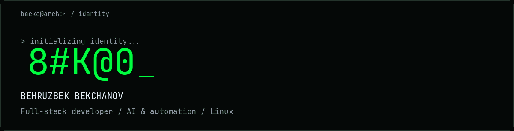
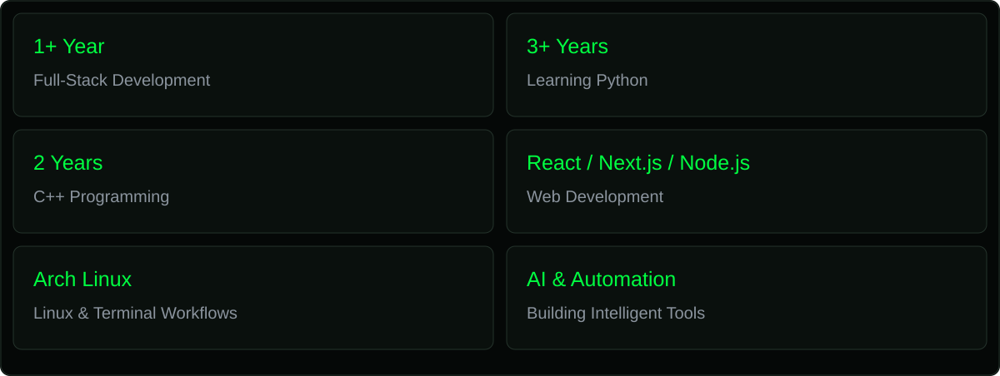
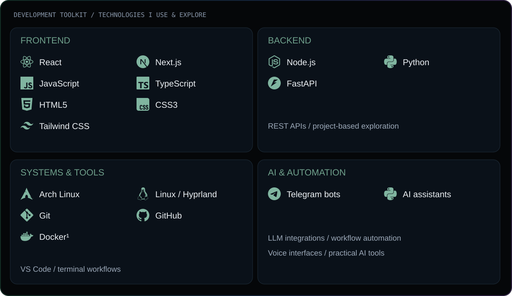
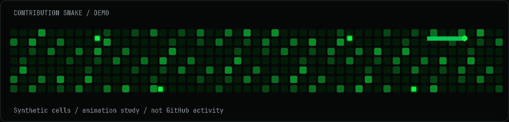
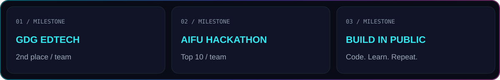

<picture>
  <source media="(prefers-reduced-motion: reduce) and (max-width: 600px)" srcset="assets/hero-mobile-static.svg">
  <source media="(prefers-reduced-motion: reduce)" srcset="assets/hero-static.svg">
  <source media="(max-width: 600px)" srcset="assets/hero-mobile.gif">
  
</picture>

<a href="#about">About</a> · <a href="#stack">Tech Stack</a> · <a href="#stats">GitHub Stats</a> · <a href="#projects">Projects</a> · <a href="#connect">Connect</a>

## 💫 About Me

I'm **Behruzbek Bekchanov**, a full-stack developer from **Uzbekistan**. I build websites, Telegram bots and AI-assisted applications, with **Node.js** as my preferred backend environment.

- 🚀 Building **eDoska**, **BECKO AI Assistant** and **BECKO Arch Linux**.
- 🧠 Exploring **AI, cybersecurity and Computer Engineering**.
- 🐧 Daily inspiration: **Arch Linux, Hyprland and terminal workflows**.
- ⚡ Hackathons, practical products and ideas that create opportunities in Uzbekistan.

## Developer Experience

<picture>
  <source media="(max-width: 600px)" srcset="assets/experience-mobile-static.svg">
  
</picture>

## 💻 Tech Stack

<picture>
  <source media="(max-width: 600px)" srcset="assets/tech-stack-mobile-static.svg">
  
</picture>

## 📊 GitHub Stats

<picture>
  <source media="(prefers-reduced-motion: reduce)" srcset="assets/activity-static.svg">
  
</picture>

Refreshed daily from GitHub. Language shares are based on source bytes in public repositories.

### Contribution Snake

<picture>
  <source media="(prefers-reduced-motion: reduce)" srcset="assets/contribution-snake-static.svg">
  
</picture>

Visual demo with synthetic cells — independent of the real GitHub statistics above.

## 🏆 Hackathon Highlights

<picture>
  <source media="(max-width: 600px)" srcset="assets/trophies-mobile-static.svg">
  
</picture>

## ✍️ Dev Quote

## 03 / Selected builds

Public source is linked below. Implementation descriptions come from inspected source and documentation; live integrations still require their own configuration.

<table>
<tr><td width="50%" valign="top">

### ◈ eDOSKA
**A digital workspace for the classroom.**

Whiteboard, lessons, schedules, student selection, analytics views, AI assistant and lesson-generation components, and a Telegram Mini App interface. External AI and database integrations require configuration.

`React` `TypeScript` `Vite` `Tailwind CSS` `Supabase`

**Status:** source implementation; deployment listed in repository metadata.

[Source ↗](https://github.com/becko1602/eDoska)

</td><td width="50%" valign="top">

### ◈ BECKO AI ASSISTANT
**A voice-driven Windows assistant.**

Gemini Live conversation, screen context, desktop tools, persistent memory, Telegram remote control, and a central action-confirmation gate. Requires Windows, audio hardware, and configured API credentials.

`Python` `Gemini Live` `Tkinter` `Telegram`

**Status:** self-hosted implementation; customized from [Kaizumi by Musayev Doniyor](https://github.com/MusayevDoniyor/kaizumi), with upstream attribution preserved.

[Source ↗](https://github.com/becko1602/Becko)

</td></tr>
<tr><td width="50%" valign="top">

### ◈ BECKO ARCH LINUX
**A native terminal voice assistant for Arch.**

Gemini Live, a Textual terminal interface, sounddevice/PipeWire audio, system information and Linux desktop tools. A separate Linux implementation, with live voice requiring a configured Gemini key.

`Python` `Textual` `google-genai` `sounddevice` `psutil`

**Status:** source implementation; hardware and API setup required.

[Source ↗](https://github.com/becko1602/becko-arch-linux)

</td><td width="50%" valign="top">

### ◈ BUILDING IN THE OPEN
**Small steps count, too.**

[Code](https://github.com/becko1602/Code) and [Test-1](https://github.com/becko1602/Test-1) are small practice repositories; their metadata does not establish a substantial product or technology stack.

[All public repositories ↗](https://github.com/becko1602?tab=repositories)

</td></tr>
</table>

<b>Local projects &amp; product directions</b> — source visibility and implementation boundaries

| Project | Evidence and current scope | Stack / status |
| :--- | :--- | :--- |
| **OLYMPIX** | Local exam-preparation application for IELTS and Digital SAT, with practice and diagnostic flows described in its source documentation. Daily challenges, AI study planning and multilingual ambitions are not all established as working integrations. | Next.js, React, TypeScript, Tailwind, Supabase. Local implementation; no public repository verified. |
| **SMART MARKET PRICES** | Local competition MVP with supplier comparison, quantity requests, persisted workflows, synthetic market demonstrations and configurable AI/voice interpretation. Telegram integration code exists; operation of the user-supplied [@SmartMarketPricesBot](https://t.me/SmartMarketPricesBot) was not verified. | Next.js, TypeScript, Node.js, SQLite; PostgreSQL/Prisma path documented but requires validation. No public repository verified. |
| **UZEX INTELLIGENCE** | Local FastAPI/DuckDB analytics backend and React dashboard: read-only queries, transaction search, regional/year comparisons, Uzbek/Russian assistant and Telegram integration code. No forecasting or live deployment claim. The requested `uzex-backend` and `uzex-frontend` were not in the public repository listing. | Python, FastAPI, DuckDB, React, Vite, aiogram, Docker. Local implementation; database and live integration verification required. |
| **FALCON** | Cybersecurity learning concept: interactive lessons, CTF-style challenges, progress, leaderboards and personalization are proposed features. | Concept supplied by the author; source and stack not verified. |

No repository or demo URLs are invented for these projects.

## 🌐 Connect

